#  Aquafinder

Make Mac OS X 10.3.9 Panther and 10.4.11 Tiger look and fit better on small screens, like 800×600 G3 iBooks.


## What it does

**Finder**
- Plain Aqua windows instead of brushed metal. The toolbar and sidebar stay.
- As in Jaguar, the item count sits under the toolbar, between two thin lines, instead of in a
  bar at the bottom. The sidebar and files run to the bottom of the window, and the resize corner
  sits in the scroll bar's corner as in any Aqua window. The bar redraws with the window, so it
  doesn't come up white in a window opened while the display sleeps. (Panther)
- The sidebar divider looks like the column view's dividers, as in Jaguar: a soft 15 px gray
  gradient with its grip near the bottom, and no other lines around the panes. Collapse the
  sidebar and the divider stays at the window's left edge, so you can drag it back out.
- The sidebar divider redraws cleanly when you drag it or resize the window.
- Optional: a **sidebar style**. Pick one in the Aquafinder app, or install it with
  `sudo sh aquafinder.sh install stripes`, `install header` or `install well`
  (`restore` and the same name bring back the plain sidebar):
  - **Pinstriped**: the sidebar gets the window's pinstripes, in step with the item count
    bar above it, and a slim 7 px divider: the same stripes with a soft shadow falling from a
    1 px line by the files, and a small arrow at its middle that stays clear of the window's
    edge when the sidebar is collapsed. The sidebar and the file list start right under the
    item count bar's line, as in Jaguar. The stripes stay put when the sidebar scrolls, and
    behind items you select or drag.
  - **List header**: a white sidebar under an Aqua list header labeled "Places", like the
    file list's column header beside it and like the panes of Jaguar's Address Book, with a
    1 px line for a divider. The header's label turns gray in an inactive window, as the file
    list's does.
  - **Inset**: the sidebar as a white list inset on the window's pinstripes, framed like an
    Aqua list box (as in Jaguar's System Preferences), 9 px in from the window's edges, with
    a 9 px divider of pinstripes ending in a 1 px line by the files.

  In every style, the line between the volumes and the places in the sidebar sits in the
  middle of what reads as the sidebar, with as much room at either end.

  With the list header and the inset sidebar, the item count bar has no line of its own
  under it: the top edge is the sidebar's header or the inset list's frame, and over the files
  the file list's header, or a 1 px line in icon and column view, all on one row. Beside the
  inset list, the divider's pinstripes run up into the bar.

  | | |
  |---|---|
  | 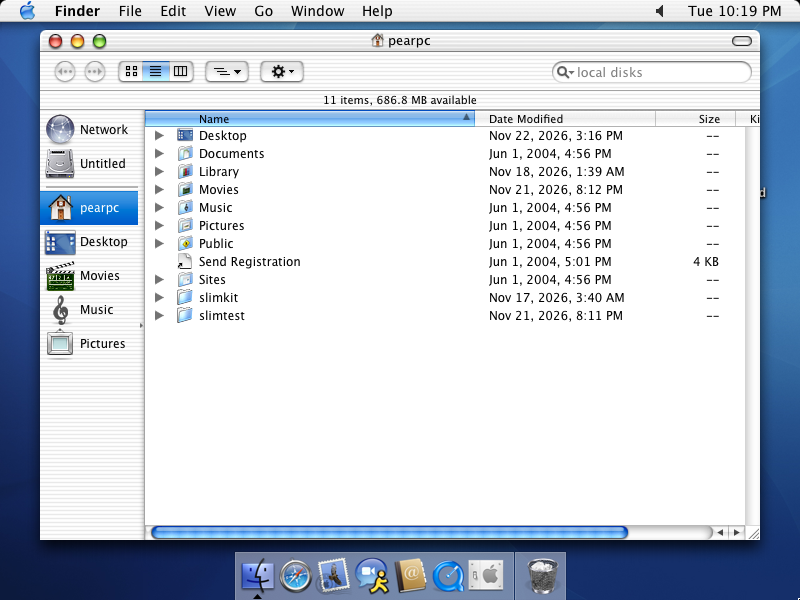 | 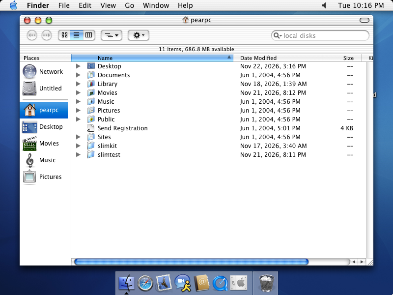 |
  | Pinstriped | List header |
  | 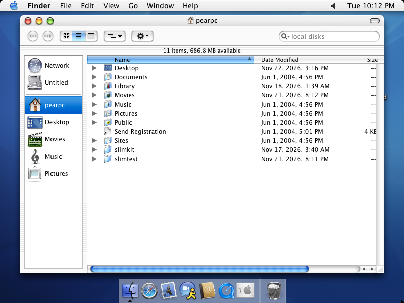 | |
  | Inset | |
- In search results, the splitter above the path pane is Panther's Aqua splitter bar: a light
  gray bar with a three-line grip in its middle, instead of the metal one. (Panther)
- In Tiger's search window, the bar with Servers, Computer, Home and Others has the same
  pinstripes as the item count bar, and the lines under it and above the path pane are a
  lighter gray. (Tiger)
- Jaguar's toolbar buttons: round Back and Forward buttons and the capsule-shaped View control,
  taken from Jaguar's Finder in every state (pressed, selected, inactive, Graphite). The Action
  (gear) and Path buttons, which Jaguar didn't have, get matching capsules, and every button sits
  the same 9 px from the next. Back and Forward sit 6 px apart, and in an inactive window the View
  control fades with the other buttons. In Tiger's search window, the View control's Group button
  gets the same capsule, with two stacked boxes drawn from Jaguar's Column symbol.
- A smaller loading spinner (13 px). It comes from the system theme, so it's installed with the
  title bars and every spinner in the system gets the same size.

**Title bars**
- Pinstriped title bars from Jaguar (10.2) in every app.
- Inactive windows get see-through title bars, in both Carbon apps (like the Finder) and Cocoa apps (like TextEdit).
- Jaguar's close, minimize and zoom buttons: the larger, glossier ones, in Aqua and Graphite,
  spaced 22 px apart as in Jaguar, in Carbon and Cocoa apps. Where Tiger draws a button that's
  off in an active window as a clear bead, it gets Jaguar's faded gray one.

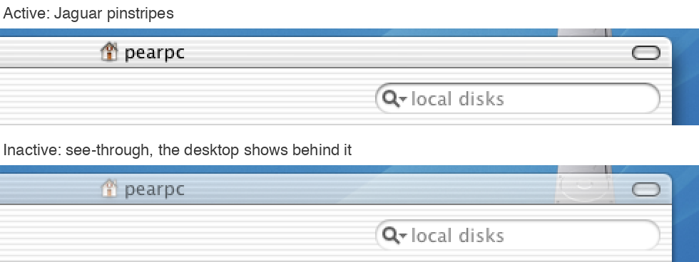
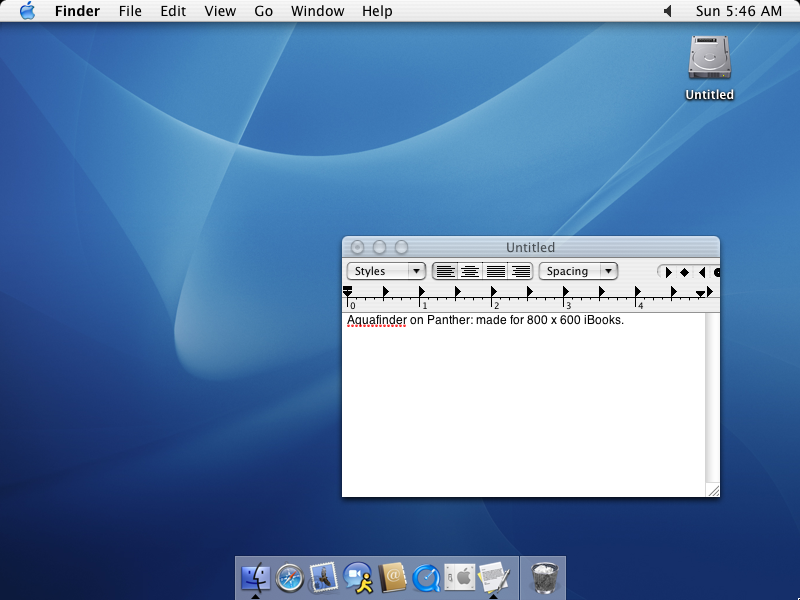

**Logo**
- Jaguar's Apple Garamond "Mac OS X" in About This Mac and on the login and Welcome panel,
  instead of Panther's Myriad.
- Jaguar's Finder icon, in the Finder and in the Dock.

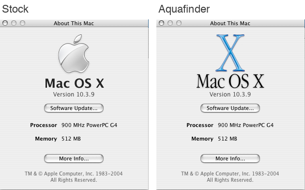
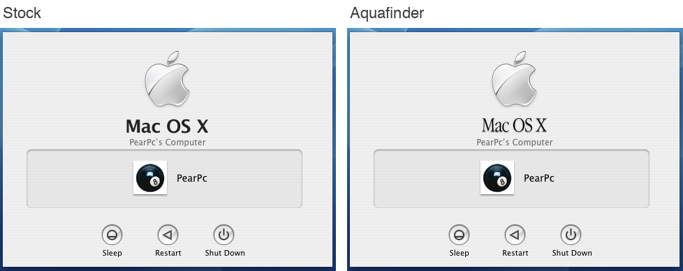
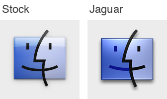

**On Tiger**

The same parts, the same look, from one script. Tiger's Finder was largely rewritten, so its
changes were found again from scratch; the title bar art, About This Mac logo, Finder icon and
Dock tile are the same files as Panther's.

| | |
|---|---|
| 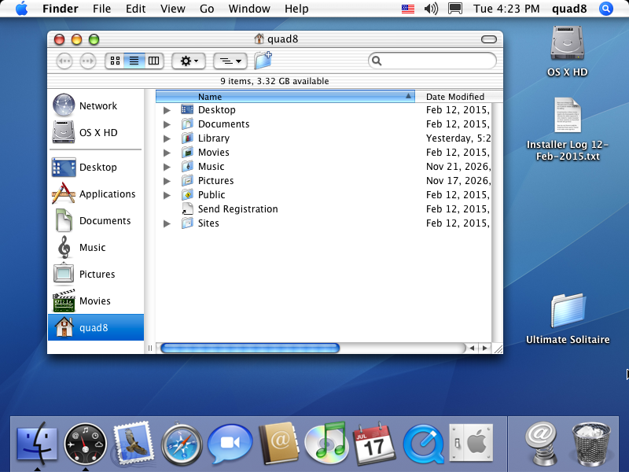 | 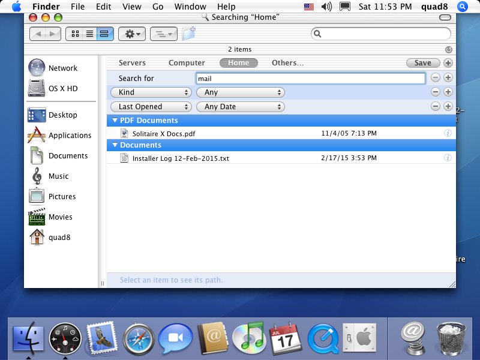 |
| A Finder window on Tiger | Tiger's search window |

| | |
|---|---|
| 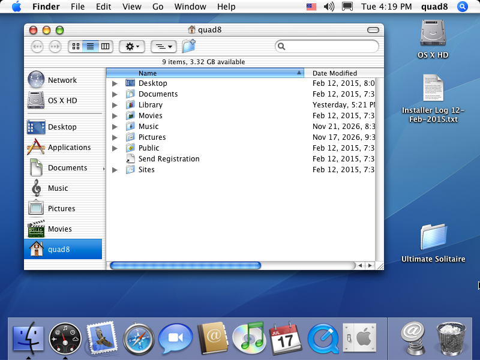 | 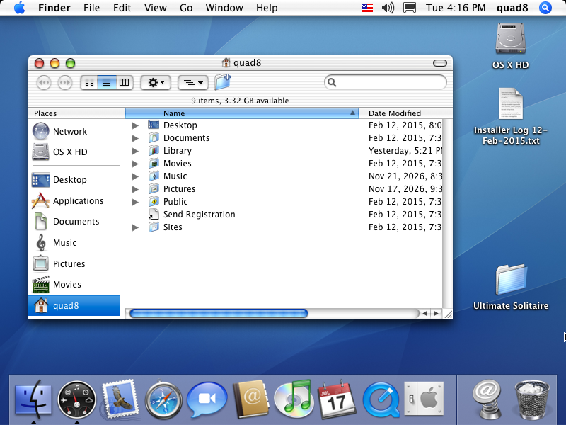 |
| Pinstriped sidebar on Tiger | List header on Tiger |
| 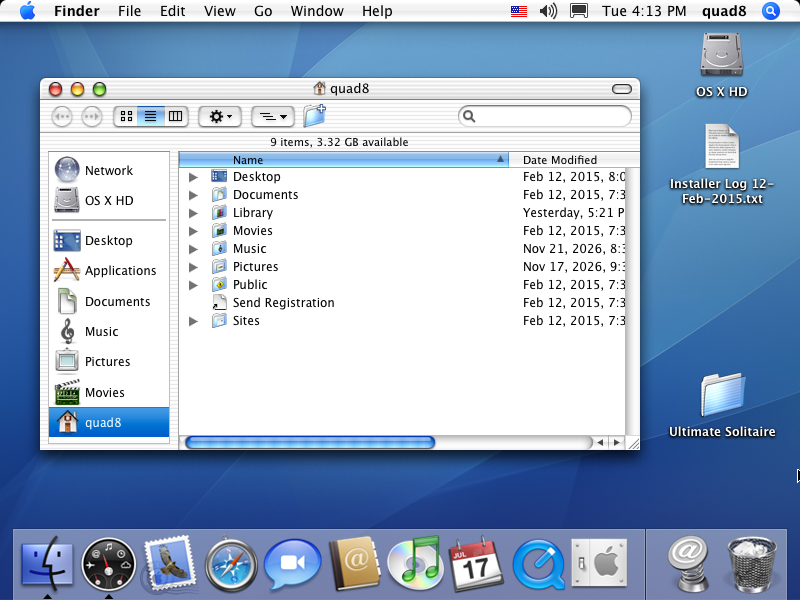 | |
| Inset sidebar on Tiger | |

## Install

The easy way, on Panther or Tiger:

1. Copy [`dist/Aquafinder.dmg`](dist/Aquafinder.dmg) to the Mac and open it.
2. Double-click **Aquafinder.pkg** and follow the installer.
3. Restart when it asks.

This patches all three parts and puts the **Aquafinder** app in your Applications folder.
Open the app any time to turn any part off or back on.
Click an option to see a before and after picture of it; the "after" follows what you tick.
Untick a part and click Apply to put Apple's original files back.

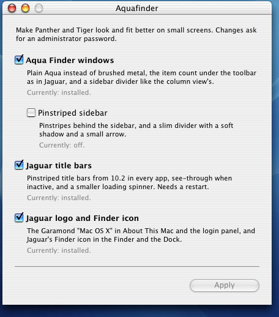

### From Terminal

1. Copy [`dist/aquafinder.sh`](dist/aquafinder.sh) to the Mac (a USB stick works).
2. Open Terminal and run:

   ```sh
   sudo sh aquafinder.sh install
   ```

3. Restart the Mac.

To **update** to a newer version, run the same `install` command with the new script and restart.
It upgrades files patched by an older version, starting from the saved originals.

You can also install just one part: `install finder`, `install titlebars` or `install logo`.
`install stripes`, `install header` or `install well` switches the Finder part to that sidebar
style, and `restore` with the same name back to the plain one (`install finder` keeps
whichever sidebar is installed).
Check what's installed with `sh aquafinder.sh status`.

## Undo

Untick every part in the Aquafinder app and click Apply, or run:

```sh
sudo sh aquafinder.sh restore
```

Then restart. The original files are kept in `/Library/Aquafinder/`.

## Good to know

- Only works on **Mac OS X 10.3.9** and **10.4.11**. The script recognises each file it patches
  by its exact contents; anything else (another version, an already modified file) it leaves alone.
- The script checks every file before it changes it, keeps a backup, and checks the result.
- It needs nothing beyond a standard Panther or Tiger install.
- Tested in QEMU, on Panther including with Quartz Extreme on an emulated Radeon 9000.

## More screenshots

| | |
|---|---|
| 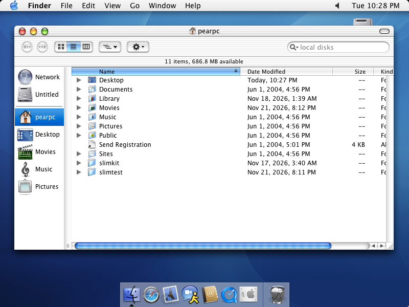 | 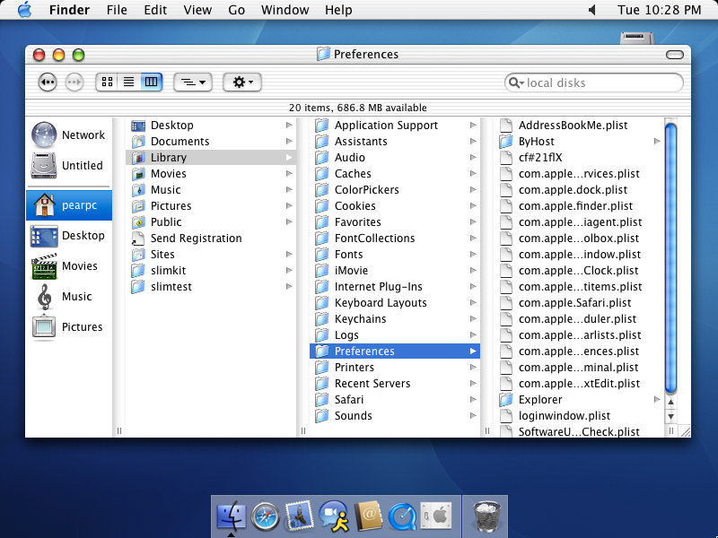 |
| List view | Column view |
| 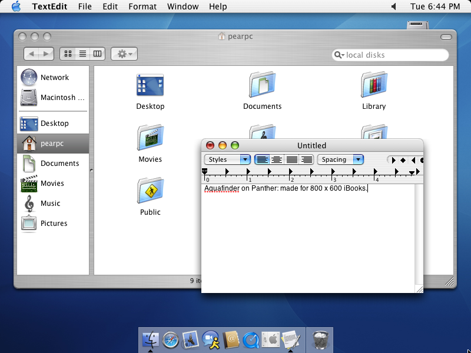 | 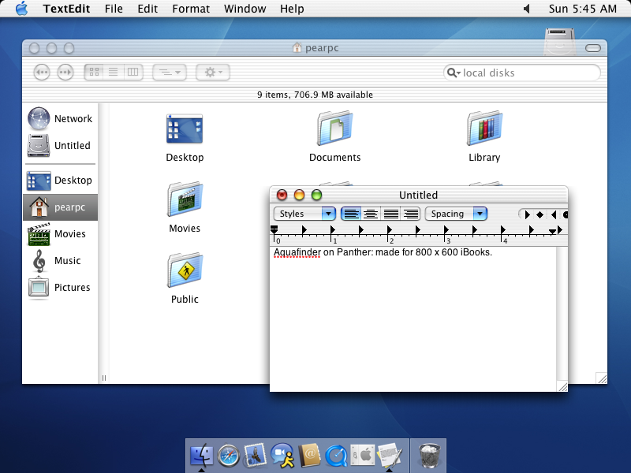 |
| Stock: TextEdit in front of an inactive Finder | The same with Aquafinder |

## For developers

The `tools/` folder has everything used to build the script: a small PowerPC disassembler,
the patch definitions (`patch.py`, `appkit_patch.py`, `theme.py`) and helpers for testing in QEMU.

To rebuild `dist/aquafinder.sh`, put your own copies of the Apple files in `orig/` and `theme/`
(they aren't in this repo): for Tiger, `orig/tiger-10.4.11/` (Finder, Finder.rsrc, AppKit) and
`theme/tiger-10.4.11/Extras.rsrc`, from 10.4.11 (8S165). The logo part also reads `orig/logo/`
(files from 10.3.9, 10.4.11 and 10.2.8, listed in `tools/logo.py`) and needs Pillow. The toolbar
buttons read Jaguar's Finder art from `orig/jaguar-10.2.8/Finder-Localized.rsrc` (10.2.8's
`Finder.app/Contents/Resources/English.lproj/Localized.rsrc`; see `tools/toolbar.py`). Then run:

```sh
python3 tools/mkinstaller.py
```

The app and the installer package are built on a real Panther Mac with the Developer Tools,
since nothing current can compile PowerPC Cocoa code. Rebuild the script first, then:

```sh
tools/mknative.sh 1.0
```

The sidebar header's images are built by `tools/header.py`: the Aqua list header's texture,
measured from a running Finder, with the "Places" label as Cocoa draws it (rendered once in a VM
by `tools/label.m`; its pixels are kept in `header.py`).

The app's icon (`gui/Aquafinder.icns`) is drawn by `tools/appicon.py`, and its before/after
pictures (`gui/preview/`) are cut from `screens/` by `tools/previews.py`; rerun those after
changing them.

It copies `gui/`, `pkg/` and the script over SSH, builds there with `tools/native-build.sh`,
and fetches `dist/Aquafinder.dmg`. The same app and package run on Tiger. If sudo there needs a password, the build stops and prints the
command to run in Terminal on the Mac; then fetch the result with `FETCH_ONLY=1 tools/mknative.sh 1.0`. Both the app and the package run `aquafinder.sh` to do the work,
so they make the same checks.

Tiger's Finder changes are in `TIGER_PATCHES` (and `TIGER_STRIPES_PATCHES`, `TIGER_HEADER_PATCHES`
and `TIGER_WELL_PATCHES` for the sidebar styles) in `tools/patch.py`, at 10.4.11's own addresses
(its code is too different for the signature matching used for Panther builds), with the new
drawing code in `tools/cave.py`. Tiger's Back/Forward and View controls are theme-drawn
segmented views, so its 'toolbar' set gives each one a small Carbon event handler
(`cave.build_tiger_toolbar`) that draws Jaguar's images and hit-tests by their slots. When a
segment turns on or off, the whole control is redrawn: HIToolbox would only redraw its own,
smaller segment rect.
`tools/vm-push.sh` takes `VMHOST=tiger-root` to swap a file into
a running Tiger VM.

To publish a new version, follow [`RELEASING.md`](RELEASING.md).

## About

Made by [Caipe97](https://github.com/Caipe97). Source, updates and bug reports:
[github.com/Caipe97/Aquafinder](https://github.com/Caipe97/Aquafinder). MIT License.

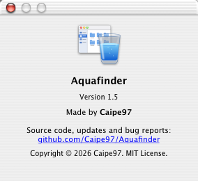
