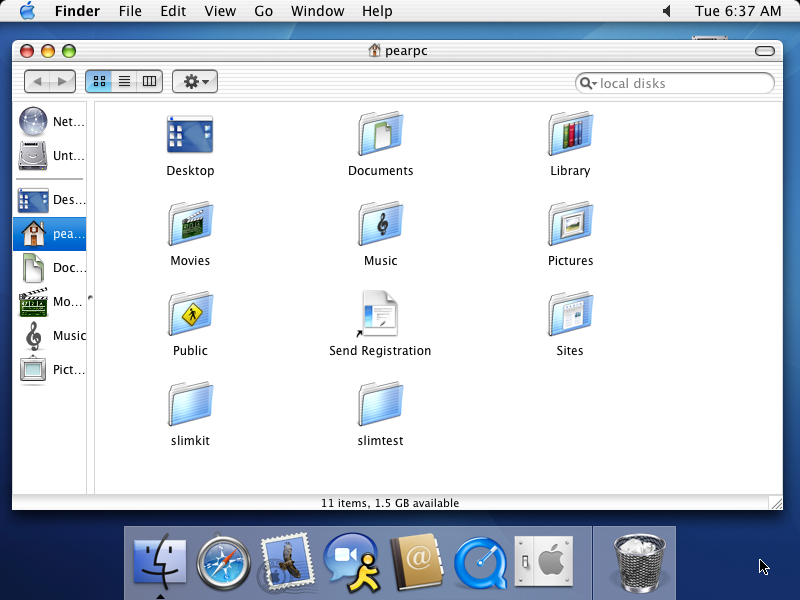
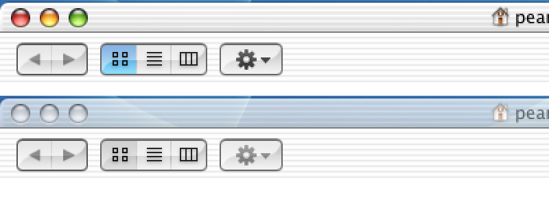
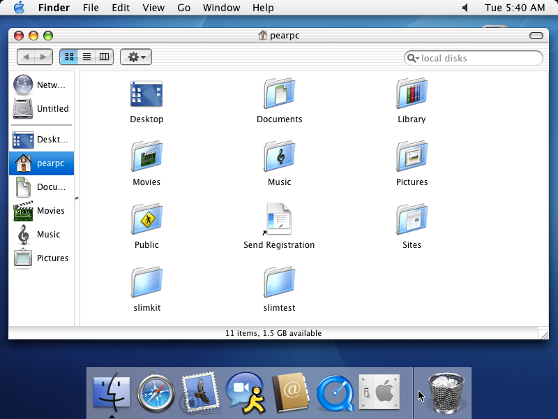

# panther-slim

Make Mac OS X 10.3.9 Panther look and fit better on small screens, like 800×600 G3 iBooks.


## What it does

**Finder**
- Plain Aqua windows instead of brushed metal. The toolbar and sidebar stay.
- A thinner bottom bar (15 px, the same height as the resize corner) with a soft Jaguar-style shadow.
- Lighter, softer lines around the panes.
- The sidebar divider redraws cleanly when you drag it or resize the window.



**Title bars**
- Pinstriped title bars from Jaguar (10.2) in every app.
- Inactive windows get see-through title bars, in both Carbon apps (like the Finder) and Cocoa apps (like TextEdit).




## Install

1. Copy [`dist/panther-slim.sh`](dist/panther-slim.sh) to the Mac (a USB stick works).
2. Open Terminal and run:

   ```sh
   sudo sh panther-slim.sh install
   ```

3. Restart the Mac.

You can also install just one part: `install finder` or `install titlebars`.
Check what's installed with `sh panther-slim.sh status`.

## Undo

```sh
sudo sh panther-slim.sh restore
```

Then restart. The original files are kept in `/Library/PantherSlim/`.

## Good to know

- Only works on **Mac OS X 10.3.9**. On anything else the script does nothing.
- The script checks every file before it changes it, keeps a backup, and checks the result.
- It needs nothing beyond a standard Panther install.
- Tested in QEMU, including with Quartz Extreme on an emulated Radeon 9000:

  

## More screenshots

| | |
|---|---|
|  |  |
| Stock Panther | Patched Finder |
|  |  |
| List view | Column view |
|  |  |
| Inactive title bar | Cocoa app (TextEdit) |
|  |  |
| Bottom bar shadow | Quartz Extreme, inactive Cocoa window |

## For developers

The `tools/` folder has everything used to build the script: a small PowerPC disassembler,
the patch definitions (`patch.py`, `appkit_patch.py`, `theme.py`) and helpers for testing in QEMU.

To rebuild `dist/panther-slim.sh`, put your own copies of the Apple files in `orig/` and `theme/`
(they aren't in this repo), then run:

```sh
python3 tools/mkinstaller.py
```
