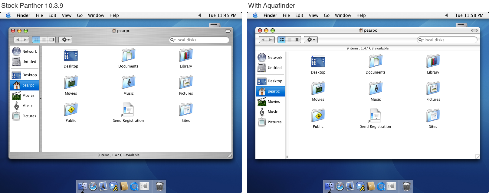
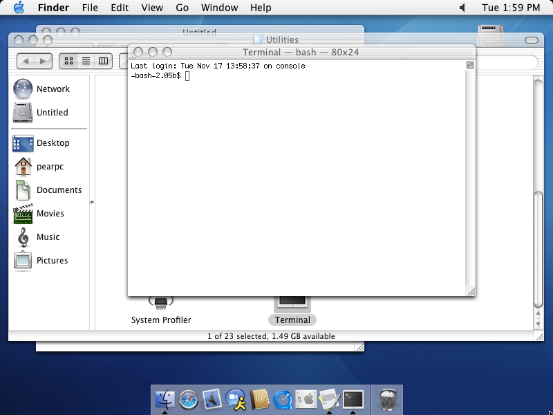
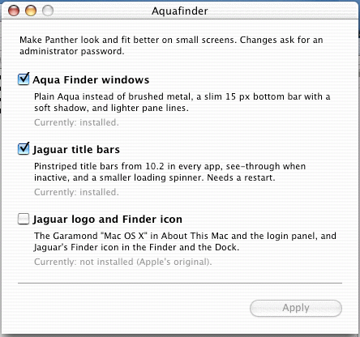
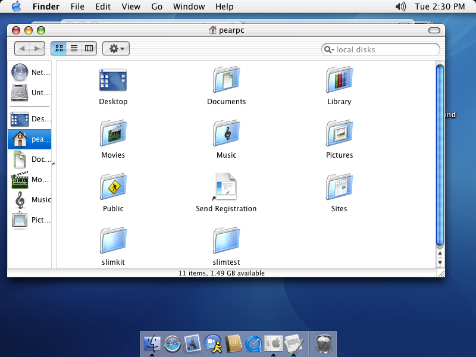
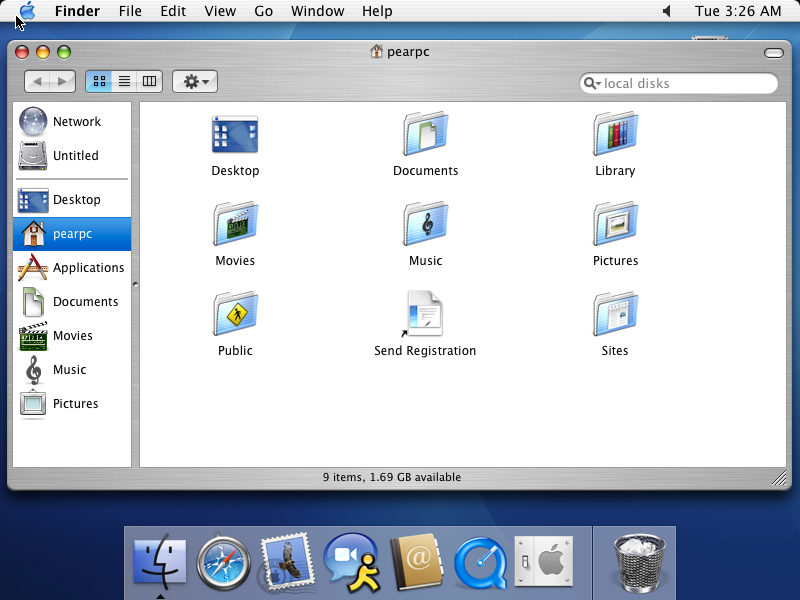
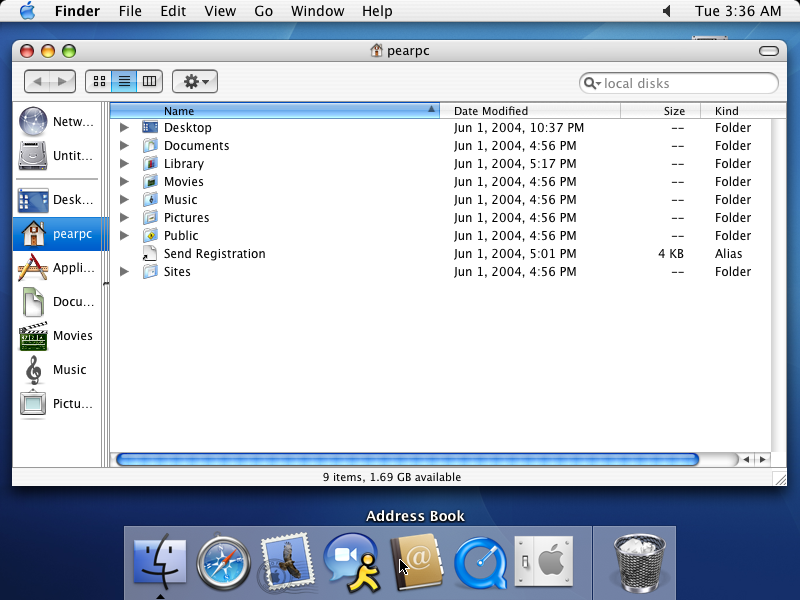
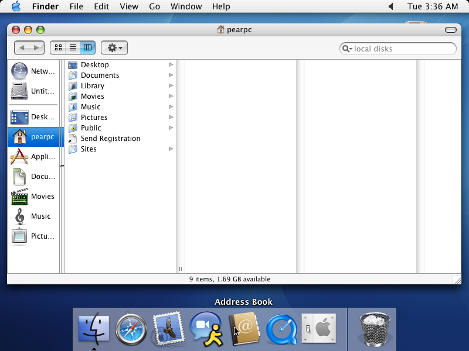
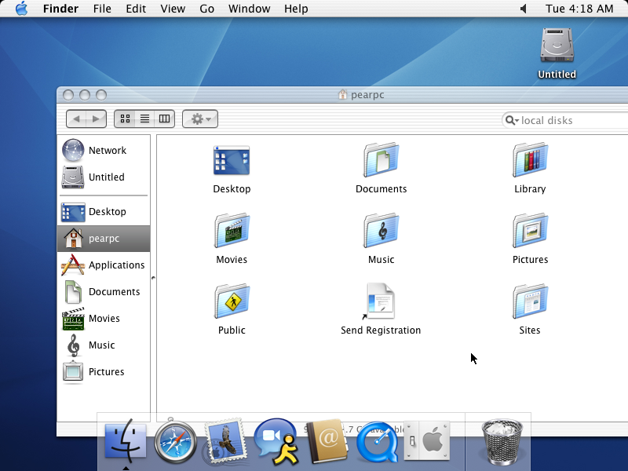
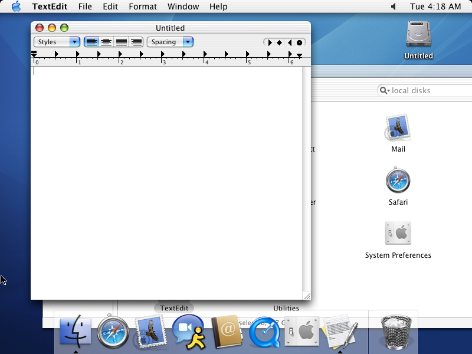
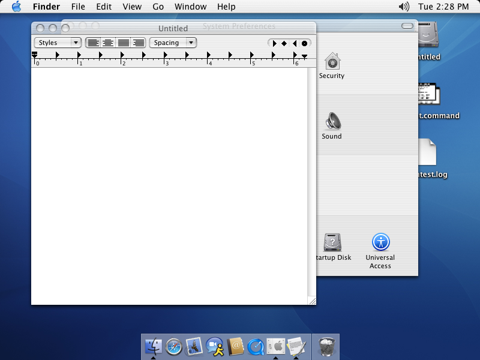

# Aquafinder

Make Mac OS X 10.3.9 Panther look and fit better on small screens, like 800×600 G3 iBooks.



## What it does

**Finder**
- Plain Aqua windows instead of brushed metal. The toolbar and sidebar stay.
- A thinner bottom bar (15 px, the same height as the resize corner) with a soft Jaguar-style shadow.
- Lighter, softer lines around the panes.
- The sidebar divider redraws cleanly when you drag it or resize the window.
- A smaller loading spinner (13 px) that fits the thinner bar. It comes from the system theme,
  so it's installed with the title bars and every spinner in the system gets the same size.


**Title bars**
- Pinstriped title bars from Jaguar (10.2) in every app.
- Inactive windows get see-through title bars, in both Carbon apps (like the Finder) and Cocoa apps (like TextEdit).




**Logo**
- Jaguar's Apple Garamond "Mac OS X" in About This Mac and on the login and Welcome panel,
  instead of Panther's Myriad.
- Jaguar's Finder icon, in the Finder and in the Dock.

## Install

The easy way:

1. Copy [`dist/Aquafinder.dmg`](dist/Aquafinder.dmg) to the Mac and open it.
2. Double-click **Aquafinder.pkg** and follow the installer.
3. Restart when it asks.

This patches all three parts and puts the **Aquafinder** app in your Applications folder.
Open the app any time to turn any part off or back on.
Untick a part and click Apply to put Apple's original files back.



### From Terminal

1. Copy [`dist/aquafinder.sh`](dist/aquafinder.sh) to the Mac (a USB stick works).
2. Open Terminal and run:

   ```sh
   sudo sh aquafinder.sh install
   ```

3. Restart the Mac.

To **update** to a newer version, run the same `install` command with the new script and restart.
It upgrades files patched by an older version, starting from the saved originals.

You can also install just one part: `install finder`, `install titlebars` or `install logo`.
Check what's installed with `sh aquafinder.sh status`.

## Undo

Untick every part in the Aquafinder app and click Apply, or run:

```sh
sudo sh aquafinder.sh restore
```

Then restart. The original files are kept in `/Library/Aquafinder/`.

## Good to know

- Only works on **Mac OS X 10.3.9**. On anything else the script does nothing.
- The script checks every file before it changes it, keeps a backup, and checks the result.
- It needs nothing beyond a standard Panther install.
- Tested in QEMU, including with Quartz Extreme on an emulated Radeon 9000:

  

## More screenshots

| | |
|---|---|
|  |  |
| Stock Panther | Patched Finder |
|  |  |
| List view | Column view |
|  |  |
| Inactive title bar | Cocoa app (TextEdit) |
|  |  |
| Bottom bar shadow | Quartz Extreme, inactive Cocoa window |

## For developers

The `tools/` folder has everything used to build the script: a small PowerPC disassembler,
the patch definitions (`patch.py`, `appkit_patch.py`, `theme.py`) and helpers for testing in QEMU.

To rebuild `dist/aquafinder.sh`, put your own copies of the Apple files in `orig/` and `theme/`
(they aren't in this repo). The logo part also reads `orig/logo/` (files from 10.3.9 and 10.2.8,
listed in `tools/logo.py`) and needs Pillow. Then run:

```sh
python3 tools/mkinstaller.py
```

The app and the installer package are built on a real Panther Mac with the Developer Tools,
since nothing current can compile PowerPC Cocoa code. Rebuild the script first, run `sudo -v`
on the Mac, then:

```sh
tools/mknative.sh 1.0
```

It copies `gui/`, `pkg/` and the script over SSH, builds there with `tools/native-build.sh`,
and fetches `dist/Aquafinder.dmg`. Both the app and the package run `aquafinder.sh` to do the work,
so they make the same checks.
